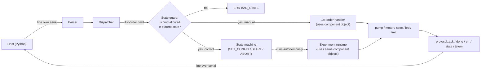
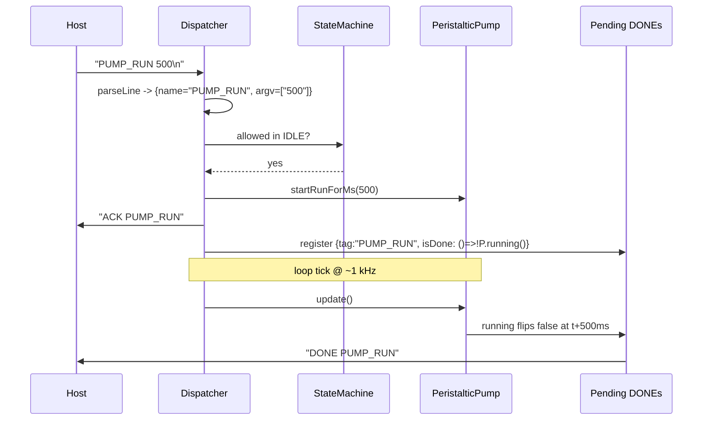
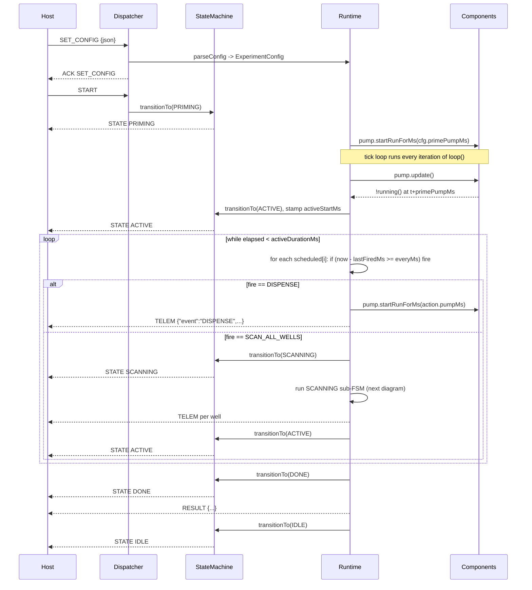
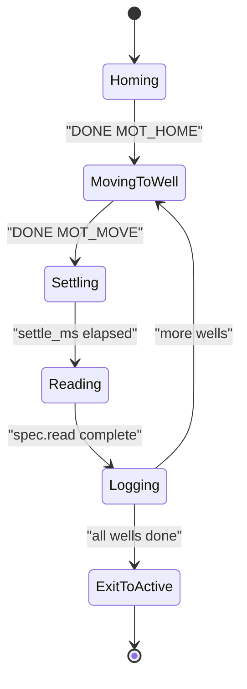
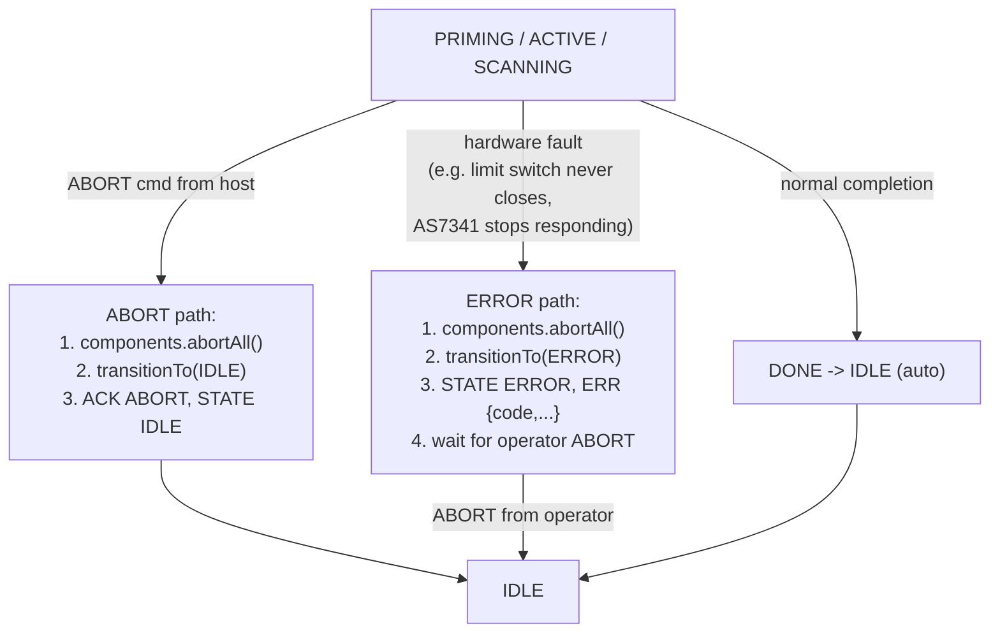
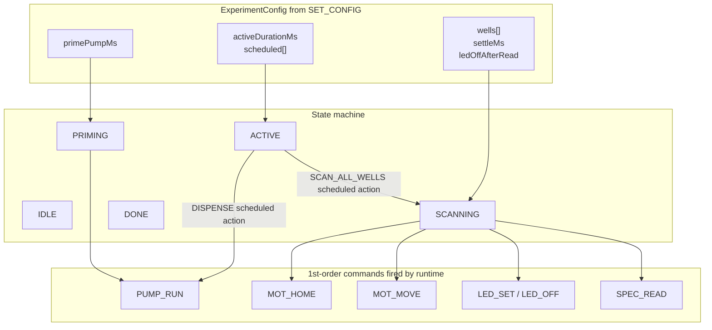

# Biopayload Software: How States and Commands interact in Mission and Test

## 1. Mental model: one state machine, two control surfaces



The same component objects (`PeristalticPump`, `LinearActuator`, `SpectralSensor`, `RGBLed`, `LimitSwitch`) are driven by **two callers**: direct 1st-order command handlers (manual / debug / host orchestration) and the experiment runtime (autonomous after `START`). The state machine arbitrates by gating which caller is "in charge" at any given moment.

## 2. The state guard — the contract every command obeys

Each entry in the dispatcher table has an `allowedStates` mask. Conceptually:

| Command family | IDLE | PRIMING | ACTIVE | SCANNING | DONE | ERROR |
|----------------|:----:|:-------:|:------:|:--------:|:----:|:-----:|
| `PING` / `HELLO` / `STATE` | yes | yes | yes | yes | yes | yes |
| `ABORT` | yes | yes | yes | yes | yes | yes |
| `SET_CONFIG` | yes | no | no | no | no | no |
| `START` | yes | no | no | no | no | no |
| Reads (`PUMP_STATUS`, `MOT_POS`, `SPEC_READ`, `LED_STATUS`, `LIM_STATUS`, `MOT_STATUS`, `SPEC_STATUS`) | yes | yes | yes | yes | yes | yes |
| Writes (`PUMP_RUN/ON/OFF`, `MOT_MOVE/RUN/STOP/HOME/EN/DIS`, `LED_SET/OFF`, `SPEC_GAIN/ATIME/ASTEP`) | **yes** | no | no | no | no | no |

**Why this split.** The runtime "owns" the actuators while an experiment is running. Letting the host send `PUMP_ON` mid-`SCANNING` would race the runtime's own pump usage. But observational reads are always safe and useful (the host wants to know `MOT_POS` during a scan for live UI). `ABORT` works everywhere by definition.

When a guard rejects a command:

```text
> PUMP_RUN 500
ERR BAD_STATE PUMP_RUN not allowed in SCANNING
```

The guard runs *before* the handler even looks at args, so a rejected command never touches a component. The component never has to care which mode the system is in.

## 3. How a single 1st-order command flows (manual mode)



Three rules this makes concrete:

- `ACK` is **synchronous** — sent before the handler returns. It just confirms "I understood and accepted the command".
- `DONE` is **asynchronous** — sent later by the pending-DONE tracker when the component reports completion. Instant commands (`PUMP_ON`, `LED_SET`) skip `DONE` entirely; they have a self-contained `ACK PUMP_ON` / `ACK LED_SET`.
- The handler doesn't busy-wait. The component class is non-blocking; the dispatcher polls it.

## 4. How an autonomous experiment flows



A few subtleties that fall out of the design and matter when reading the wire:

- **`ACK` is sent before the state transition**, so the host always sees `ACK START` *then* `STATE PRIMING`. Same for `ACK ABORT` then `STATE IDLE`.
- **`scheduled[i].lastFiredMs` is stamped when an action *starts* firing**, not when it ends. So `every_s: 300` means "next scan starts 300 s after the previous one started," regardless of how long SCANNING took. If `everyMs < scan_duration`, scans are back-to-back rather than dropped — also a rule we should explicitly document.
- **Experiment elapsed time keeps ticking through SCANNING.** `activeDurationMs` is wall-clock from `activeStartMs`, so if your `duration_s` is 60 and SCANNING burns 10 s of it, you get 50 s of post-scan ACTIVE. This is the cleanest semantics for "experiment lasts N seconds total."
- **`SET_CONFIG` is rejected mid-run** (`ERR BAD_STATE`). Config is immutable once `START` is accepted, matching MVP.md assumption #14.

## 5. SCANNING as a sub-FSM (no STATE messages emitted internally)



These sub-states are **internal to the runtime** — the wire only ever sees `STATE SCANNING` once on entry and `STATE ACTIVE` once on exit. Per-well progress is reported via `TELEM`:

```text
STATE SCANNING
TELEM {"phase":"scan","well":[0,0],"f6_590nm":812,"clear":3201,"pos":1200}
TELEM {"phase":"scan","well":[0,1],"f6_590nm":745,"clear":3198,"pos":2400}
...
STATE ACTIVE
```

`MOT_HOME` and `MOT_MOVE` reuse the exact same internal "pending DONE" plumbing as the 1st-order commands — the runtime calls `motor.startMoveSteps(well.stepsFromHome - motor.position())` and waits for `motor.moving() == false`. The component doesn't know whether it's serving a manual `MOT_MOVE` or an autonomous scan step.

## 6. ABORT and ERROR — how everything bottoms out safely

There are exactly three ways to leave a "running" state, and they all converge on `IDLE` with hardware off.



- **`ABORT` is the universal escape.** The handler calls `pump.abort(); motor.abort(); led.off(); spec` — a single `components::abortAll()` helper — *before* the state transition, so by the time `STATE IDLE` is on the wire, GPIOs are already in their safe positions. No pending `DONE` is emitted for the in-flight operation; instead the host sees `ACK ABORT` and a single `STATE IDLE`.
- **`ERROR` is a sticky state**, unlike DONE which auto-resets. The runtime drops you here on faults that the firmware can't recover from on its own: limit switch not detected during `MOT_HOME` after a timeout, AS7341 disappearing from I²C mid-experiment, JSON config mismatch found mid-run (shouldn't happen, but safety). The operator must send `ABORT` to clear it.
- **Faults during 1st-order manual commands** don't enter ERROR — they just emit `ERR <code>` and stay in IDLE. ERROR is reserved for "an experiment was running and we had to bail."

## 7. The config <-> states <-> commands triangle, in one picture



Reading this top-to-bottom: the **config sets the parameters** of each state, the **state machine sequences which state is active**, and the **runtime translates each state into a stream of 1st-order component calls** — the *exact same calls* the host could make manually in IDLE.

This is the payoff of Option D: the autonomous mode and the manual mode aren't two separate codebases. The runtime is just an in-firmware "host" that drives the same primitives, and the state machine is the seatbelt that keeps the two callers from racing.

## 8. Concrete trace, end-to-end

A 6-second toy experiment with one PRIMING action, one DISPENSE on 3 s interval, one SCAN_ALL_WELLS on 2 s interval, two wells, total ACTIVE 6 s:

```text
> SET_CONFIG {"runId":"t1","primePumpMs":500,"activeDurationMs":6000,
              "scheduled":[{"cmd":"DISPENSE","every_s":3,"args":{"pump_ms":200}},
                           {"cmd":"SCAN_ALL_WELLS","every_s":2}],
              "wells":[{"row":0,"col":0,"stepsFromHome":1200,"led":[255,0,0]},
                       {"row":0,"col":1,"stepsFromHome":2400,"led":[255,0,0]}],
              "settleMs":150,"ledOffAfterRead":true}
ACK SET_CONFIG
> START
ACK START
STATE PRIMING
                                                       ; pump pin high for 500 ms
STATE ACTIVE
                                                       ; t=0 in ACTIVE
                                                       ; scheduled[1] fires immediately (every_s=2 vs 0)
STATE SCANNING
TELEM {"phase":"scan","well":[0,0],"f6_590nm":0,...}   ; (no sensor connected -> 0)
TELEM {"phase":"scan","well":[0,1],"f6_590nm":0,...}
STATE ACTIVE
                                                       ; t~50ms
TELEM {"event":"DISPENSE","ms":200}                    ; scheduled[0] also fires at t=0
                                                       ; pump on 200 ms, still ACTIVE
                                                       ; t=2000 -> SCAN_ALL_WELLS again
STATE SCANNING
TELEM {"phase":"scan","well":[0,0],...}
TELEM {"phase":"scan","well":[0,1],...}
STATE ACTIVE
                                                       ; t=3000 -> DISPENSE again
TELEM {"event":"DISPENSE","ms":200}
                                                       ; t=4000 -> SCAN_ALL_WELLS
STATE SCANNING
...
STATE ACTIVE
                                                       ; t=6000 -> activeDurationMs reached
STATE DONE
RESULT {"runId":"t1","wells_scanned":6,"dispenses":2,"duration_s":6.0}
STATE IDLE
```

This is exactly what `[biopayload/home/test_protocol.py](biopayload/home/test_protocol.py)` (created in phase 2) will assert against, on a bare ESP32 with nothing wired up.

---

If this matches the model you had in your head, say "go" and I'll switch to agent mode and start on Phase 1. If anything in the contract above is wrong (e.g. you want SCANNING to *pause* the ACTIVE elapsed timer, or you want manual writes allowed during ACTIVE, or you want `DONE` to require a host ack before auto-resetting to IDLE), tell me which and I'll revise the plan before I touch code.

